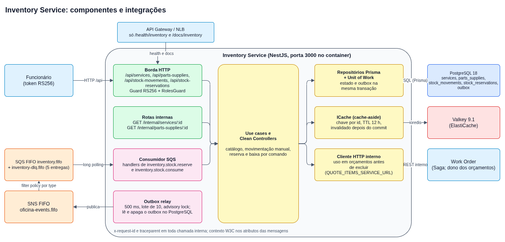

# Arquitetura

Visão do Inventory Service como está no repositório. As decisões estão nas [ADRs](adr/).

## Índice

- [Visão geral](#visão-geral)
- [Camadas](#camadas)
- [Agregados e regras de estoque](#agregados-e-regras-de-estoque)
- [Kit herdado do template](#kit-herdado-do-template)
- [Mensageria com outbox](#mensageria-com-outbox)
- [Cache do dono](#cache-do-dono)
- [Consulta de uso antes de excluir](#consulta-de-uso-antes-de-excluir)
- [Autenticação e Swagger](#autenticação-e-swagger)
- [Exceções por camada](#exceções-por-camada)
- [Modelo C4](#modelo-c4)

## Visão geral



Fonte editável em [`diagrams/src/inventory-architecture.drawio`](diagrams/src/inventory-architecture.drawio). O serviço é dono do catálogo de serviços, peças e insumos, do saldo, das reservas e das movimentações de estoque. A reserva e a baixa chegam por mensagem ([Mensageria](messaging.md)); o catálogo e a movimentação manual, por HTTP ([API](api.md)).

## Camadas

Clean Architecture com regra de dependência única: o código aponta só para dentro. A regra é imposta pela cerca ESLint de `app/eslint.config.mjs`, que falha o `npm run lint` nas violações.

| Camada | Pasta (`app/src/`) | Conteúdo hoje | Pode importar |
| --- | --- | --- | --- |
| Domínio | `domain/` | Entidades `Service`, `PartSupply`, `StockMovement` e `StockReservation`, enums, catálogo tipado de mensagens (`messaging/`), exceções de domínio, portas de repositório (`IPartSupplyRepository`, `IServiceRepository`, `IStockMovementRepository`, `IStockReservationRepository`, `IOutboxRepository`, `IUnitOfWork`) | Nada de `@nestjs/*`, Prisma nem `@opentelemetry/*` |
| Aplicação | `application/` | Use cases de `service/`, `part-supply/` e `stock/`, portas de entrada e de saída (`ICache`, `ILogger`, `IMetrics`, `IInternalHttpClient`, `IQuoteItemUsageClient`), chaves de cache, envelope de mensagem, exceções, catálogos de log e de métricas | Idem |
| Adaptadores de interface | `interface-adapters/` | Clean Controllers e Presenters de `service/`, `part-supply/` e `stock/` | Idem |
| Infraestrutura | `infrastructure/` | Borda HTTP do NestJS, Prisma, mensageria, cache, cliente HTTP interno, logging, telemetria, health | Tudo; só `infrastructure/persistence/prisma/` importa o Prisma |

Use cases e Clean Controllers são classes sem `@Injectable`: o módulo Nest os compõe com `useFactory` e o `@Controller` fino de `infrastructure/http/` só delega. As rotas de `service/`, `part-supply/`, `stock/` e `internal/` (em `infrastructure/http/controllers/`) seguem esse padrão.

## Agregados e regras de estoque

- **`PartSupply`** é o agregado do saldo: `stock`, `reservedStock` e `version` (concorrência otimista). O disponível é `stock - reservedStock`. A entidade impõe que `EXIT` e `ADJUSTMENT` nunca deixem o saldo abaixo do reservado; o banco repete a regra com um CHECK ([Banco de dados](database.md)).
- **`Service`** é o catálogo de serviços (nome único, preço base e tempo estimado).
- **`StockMovement`** registra cada entrada, saída ou ajuste, manual ou por baixa de uma ordem de serviço. **`StockReservation`** registra quanto de cada peça está reservado para uma ordem de serviço, que aqui é só o `workOrderId`, sem chave estrangeira.
- **Reserva por comando** (`inventory.stock.reserve`): tudo ou nada e idempotente por ordem de serviço; lê o saldo no PostgreSQL dentro da transação e grava reservas e o evento de resposta no outbox no mesmo commit.
- **Baixa por comando** (`inventory.stock.consume`): converte as reservas da ordem em movimentações `EXIT` com o motivo `Saída por Ordem de Serviço <workOrderId>` e apaga as reservas; repetida, não muda nada.
- Só a movimentação manual de estoque, a reserva e a baixa rodam numa transação do `IUnitOfWork`; o CRUD de serviço e de peça usa o repositório direto. Em todos, a invalidação do cache e os logs de negócio acontecem **depois** do commit.

## Kit herdado do template

O kit transversal veio do Work Order:

- `infrastructure/config`: `configureApp` (prefixo global `api`, Helmet, CORS, `SanitizeStringsPipe`, `ValidationPipe` com `whitelist`, `forbidNonWhitelisted` e `transform`, Swagger) e `resolvePort`;
- `infrastructure/http`: filtros de exceção por camada, guard de autenticação deny-by-default, estratégia JWT de funcionário, interceptors e o middleware que devolve 404 JSON fora do prefixo;
- `infrastructure/logging` e `infrastructure/telemetry`: uma linha JSON por evento no stdout, pela porta `ILogger` e por catálogos tipados, e o SDK OpenTelemetry carregado só por preload (`node --require ./dist/src/otel.js dist/src/main`);
- `infrastructure/health`: vivacidade e prontidão, com encerramento gracioso;
- `infrastructure/messaging`, `infrastructure/cache` e `infrastructure/clients`: relay do outbox, consumidor SQS, registro de handlers, adaptador Valkey e cliente HTTP interno (as rotas `/internal/...` deste serviço usam `@Public()` e `@ApiExcludeController()`, porque o guard global também as cobre, e rota com `@Roles` precisa de `@UseGuards(RolesGuard)`, que não é global).

Migration roda só como passo separado (serviço `migrate` do Compose, Job do Kubernetes no CD), nunca no `CMD` da imagem.

## Mensageria com outbox

Consistência entre serviços só por mensagem com outbox gravado na mesma transação do produtor, por REST interno ou por Saga orquestrada pelo Work Order.

```text
caso de uso --(mesma transação)--> estado + linha em `outbox`
OutboxRelayService (500 ms) --> SNS FIFO oficina-events.fifo --> SQS FIFO inventory.fifo --> SqsConsumerService --> handlers
                                                                 inventory-dlq.fifo (após 5 entregas)
```

- **Tabela `outbox`**: `id` sequencial, `message_id` único, `type`, `work_order_id` (nulo sem OS), `payload`, `trace_context` e `created_at`.
- **Relay** (`OutboxRelayService`): a cada 500 ms abre uma transação, toma `pg_try_advisory_xact_lock` (só uma réplica publica), lê até 10 linhas por `id`, publica uma a uma e apaga as publicadas na mesma transação. Na primeira falha o lote para, para não furar a ordem, e registra `messaging.outbox.publish_failed`. Nenhuma publicação começa depois de 2 s de lote.
- **`MessageGroupId`**: no `PublishCommand` do relay é `workOrderId ?? messageId`. Mensagem de uma OS usa o `workOrderId` e mantém a ordem por OS; mensagem sem OS usa o próprio `messageId`, então vira um grupo de uma mensagem só e não bloqueia nem é bloqueada por outras. O `MessageDeduplicationId` é o `messageId`, e o atributo `type` alimenta a filter policy.
- **Envelope**: `messageId`, `type`, `occurredAt`, `workOrderId` e `payload`. O contexto W3C (`traceparent`) vai gravado em `trace_context` na linha do outbox e sai nos atributos da mensagem.
- **Consumidor** (`SqsConsumerService`): lê `inventory.fifo` (nome vindo de `INVENTORY_QUEUE_NAME`, URL resolvida na inicialização), uma mensagem por vez, com long polling de 20 s. Só confirma no sucesso. Envelope inválido, payload inválido ou tipo sem handler deixam a mensagem na fila e, na quinta entrega, o SQS a move para `inventory-dlq.fifo`. O consumidor não usa o `MessageGroupId`: a ordem por grupo é garantida pela própria FIFO.
- **Catálogo de tipos** (`domain/messaging/`): consumidos `inventory.stock.reserve` e `inventory.stock.consume`; publicados `inventory.stock.reserved` e `inventory.stock.reservation_failed`. Os handlers (`infrastructure/messaging/handlers/`) só validam o envelope e delegam ao use case. Payloads e regras em [Mensageria](messaging.md).
- **Topologia local**: `app/localstack/init-topology.sh` é cópia do `oficina-mecanica-infra-messaging` e não é editado aqui.

## Cache do dono

A porta `ICache` (`get`, `set` com TTL, `delete(keys[])`) tem o adaptador `ValkeyCacheAdapter` (`ioredis`, `CACHE_URL`, TTL de `CACHE_TTL_SECONDS`, padrão 43200 s). O cache é cache-aside e só do dono: este serviço guarda no próprio Valkey apenas dados que ele mesmo escreve, e nunca o dado de outro serviço. Falha do cache nunca derruba a API: a leitura devolve falta e registra `cache.unavailable`; falha na invalidação registra `cache.invalidation_failed` e a chave expira pelo TTL. A leitura por id de serviço e de peça (`GET /:id` e as rotas internas) usa o cache, com as chaves `inventory:service:<id>` e `inventory:part-supply:<id>` e TTL de 12 h. Todo valor leva um `cacheVersion`: um valor ilegível ou de outra versão conta como falta. Atualização, movimentação, reserva, baixa e exclusão invalidam as chaves afetadas **depois do commit**, por uma função única de chaves; reserva, baixa e exclusão leem o saldo no PostgreSQL dentro da transação, nunca no cache.

## Consulta de uso antes de excluir

`DELETE` de serviço ou de peça pergunta ao dono dos orçamentos, por `GET /internal/services/:id/quote-items` e `GET /internal/parts-supplies/:id/quote-items` (base em `QUOTE_ITEMS_SERVICE_URL`), se o item está em uso. Uma resposta fora do formato `{ data: [...] }` conta como indisponibilidade, nunca como "não usado". Item em uso responde 409; dono fora do ar (rede ou 5xx) responde 503 e nada é excluído; 4xx do dono também responde 503, sem repassar o status nem a mensagem dele (o status vai para o log técnico `quote_item_usage.rejected`). Os três desfechos de indisponibilidade usam a mesma mensagem, que diz que nada foi excluído e que dá para tentar de novo.

## Autenticação e Swagger

- O guard global (`AuthenticationGuard`) exige o token de funcionário em toda rota, exceto as marcadas com `@Public()` (os health checks e as rotas `/internal`). A validação é local, RS256, com `STAFF_JWT_PUBLIC_KEY`, `kid`, `iss`, `aud`, `exp` e `typ`, sem consultar o Identity. O serviço não recebe a chave do token de cliente: token de cliente falha na assinatura e responde 401.
- O Swagger (`/api/docs` e `/api/docs-json`) é montado pelo `SwaggerModule.setup` direto no Express, **fora do router do Nest e do guard**: por isso responde sem token. É isso que permite ao DAST ler `/api/docs-json` sem credencial e ao Postman abri-lo sem token. A UI declara o esquema Bearer `access-token` para testar rotas protegidas.
- Toda chamada interna leva `x-request-id` e `traceparent`.

## Exceções por camada

Cada camada tem a própria hierarquia de exceções e um `APP_FILTER` global que a traduz em status HTTP: domínio, aplicação, infraestrutura e o `AllExceptionsFilter` para o resto. O corpo de erro é o mesmo em todos os serviços, `{statusCode, error, message}` com a mensagem em português, e nunca carrega stack, host ou texto do driver.

## Modelo C4

O C4 nível 3 (componentes) do serviço está em [c4/README.md](c4/README.md), com o fonte PlantUML em `c4/inventory-component.puml`. Os níveis 1 e 2 da solução ficam no repositório de specs.


Fonte PlantUML em [`c4/inventory-component.puml`](c4/inventory-component.puml); o PNG leva o fonte embutido (como regerar: [c4/README.md](c4/README.md#gerar-a-imagem)).
