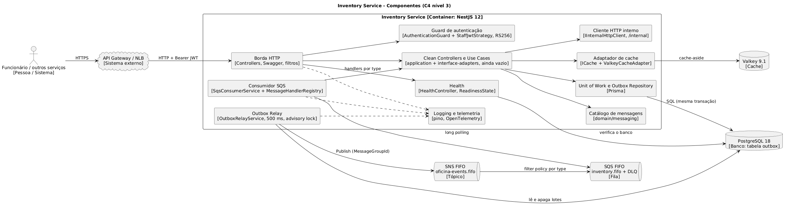

# Modelo C4: Inventory Service

Nível 3 (componentes) do container NestJS do Inventory Service. Os níveis 1 (contexto) e 2 (containers) da solução ficam no repositório de specs, na arquitetura da solução.

- Fonte: [`inventory-component.puml`](inventory-component.puml) (PlantUML, sem includes remotos).
- Imagem: [`images/c4-component.png`](images/c4-component.png), com o fonte embutido no PNG.



## Gerar a imagem

Regere o PNG sempre que o `.puml` mudar.

```bash
# A partir de docs/c4: gerar o PNG (o PlantUML grava o fonte nos metadados do PNG)
mkdir -p images
docker run --rm -i plantuml/plantuml:latest -tpng -pipe < inventory-component.puml > images/c4-component.png
```

## Elementos

### Fora do serviço

| Elemento | Tipo | Descrição |
| --- | --- | --- |
| Funcionário / outros serviços | Pessoa / Sistema | Chamam a API com o token RS256 de funcionário, pelo API Gateway |
| API Gateway / NLB | Sistema externo | Publica `/health/inventory` e `/docs/inventory` e encaminha ao NodePort 30083 |
| PostgreSQL 18 | Banco | Banco do Inventory, só deste serviço; hoje guarda a tabela `outbox` |
| Valkey 9.1 | Cache | ElastiCache do Inventory, só deste serviço |
| SNS FIFO `oficina-events.fifo` | Tópico | Destino do relay; um tópico para a solução |
| SQS FIFO `inventory.fifo` e DLQ | Fila | Fila consumida pelo serviço, com filter policy por `type` e DLQ após 5 entregas |

### Componentes do Inventory Service

| Componente | Responsabilidade |
| --- | --- |
| Borda HTTP | Controllers finos, Swagger em `/api/docs`, filtros de exceção, Helmet, CORS e pipes de validação |
| Guard de autenticação | `AuthenticationGuard` deny-by-default e `StaffJwtStrategy` (RS256, `kid`, `iss`, `aud`, `exp`, `typ`), sem consultar o Identity |
| Health | `/api/health/live` e `/api/health/ready` (prontidão confere o PostgreSQL) |
| Clean Controllers e Use Cases | Casos de uso e adaptadores de interface; ainda vazio |
| Catálogo de mensagens | Tipos `inventory.stock.reserve`, `consume`, `reserved` e `reservation_failed` |
| Unit of Work e Outbox Repository | Gravam o estado e a linha do `outbox` na mesma transação (Prisma) |
| Outbox Relay | A cada 500 ms publica até 10 linhas no SNS com `MessageGroupId` = `workOrderId` ou `messageId`, sob advisory lock |
| Consumidor SQS | Lê `inventory.fifo`, valida o envelope e o payload e despacha ao handler pelo `type` |
| Adaptador de cache | `ICache` com `ValkeyCacheAdapter`, cache-aside que degrada para o banco |
| Cliente HTTP interno | `IInternalHttpClient` para rotas `/internal/...` de outros serviços, com `x-request-id` |
| Logging e telemetria | Logs JSON no stdout e traces e métricas pelo OpenTelemetry |

Convenção: a tecnologia ou o protocolo aparece nas setas que cruzam a fronteira do serviço.
