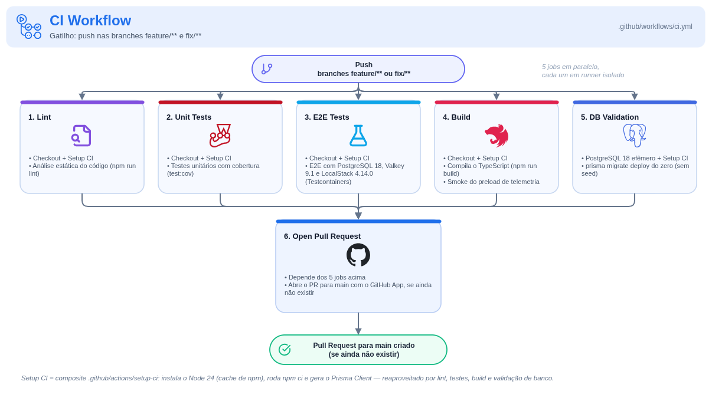
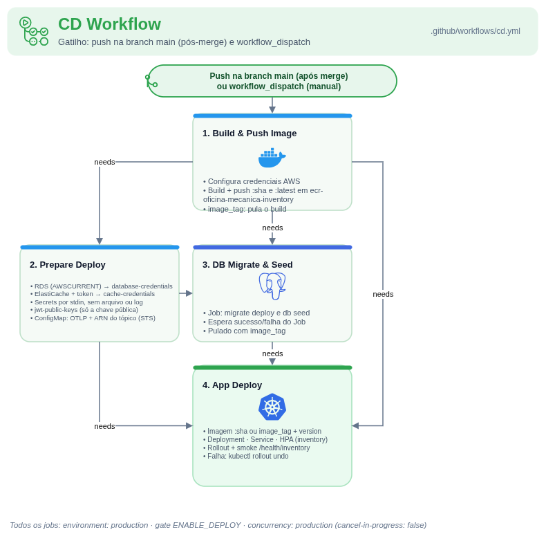
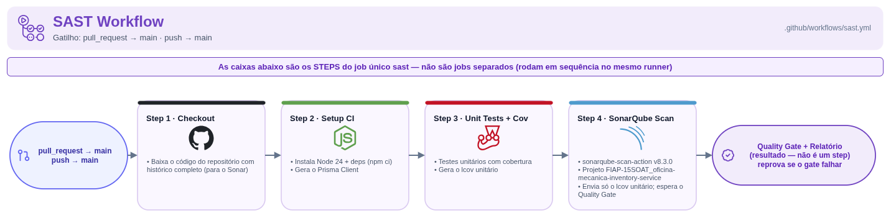
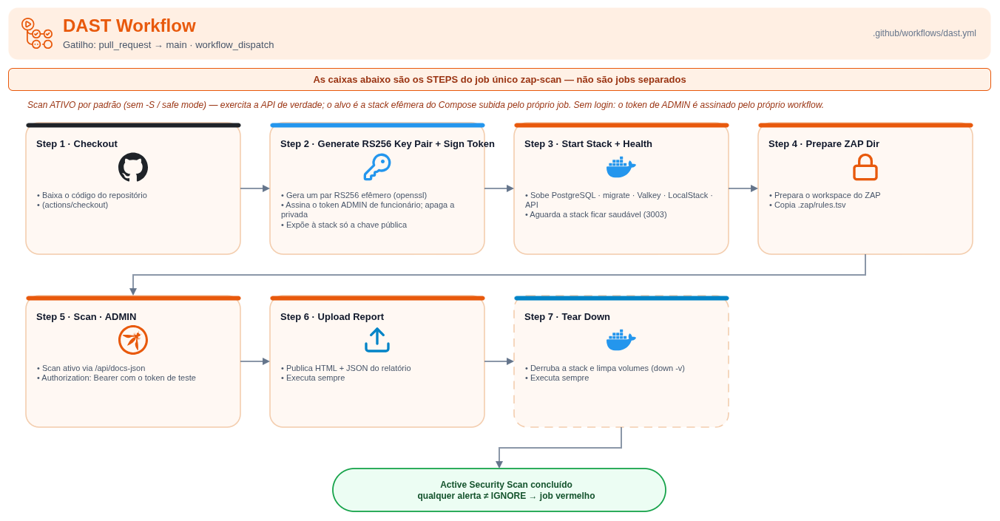

# CI/CD

Quatro workflows do GitHub Actions em `.github/workflows/`, um por responsabilidade (veja a [ADR 0002](adr/0002-pipelines-ci-cd-sast-dast-com-rollback.md)).

> O CI dispara **só em push nas branches `feature/**` e `fix/**`**. Push em outro nome de branch não roda nenhum check de CI.

| Workflow | Gatilho | Jobs |
| --- | --- | --- |
| CI | push em `feature/**` e `fix/**` | `Lint`, `Unit Tests`, `E2E Tests`, `Build`, `DB Validation` e `Open Pull Request` |
| CD | push na `main` e `workflow_dispatch` | `Build and Push App Image`, `Prepare Deployment Configuration`, `DB Migrate & Seed` e `App Deploy` |
| SAST | pull request para a `main` e push na `main` | `SAST` |
| DAST | pull request para a `main` e `workflow_dispatch` | `OWASP ZAP API Scan` |

## CI

`Lint`, `Unit Tests` (`npm run test:cov`), `E2E Tests` (`npm run test:e2e:cov`), `Build` (`npm run build` e o smoke do preload de telemetria) e `DB Validation` (`prisma migrate deploy` num PostgreSQL 18 descartável) rodam em paralelo. Só quando todos passam o job `Open Pull Request` abre o PR para a `main` com o GitHub App, se ainda não houver um aberto.

## CD

1. `Build and Push App Image`: constrói a imagem e a publica em `ecr-oficina-mecanica-inventory` com a tag do SHA. No `workflow_dispatch` com `image_tag`, só confere que a tag já existe no ECR (rollback manual, sem build).
2. `Prepare Deployment Configuration`: confere que as variables batem com os manifests, valida `STAFF_JWT_PUBLIC_KEY` e `STAFF_JWT_KEY_ID`, descobre no RDS e no Secrets Manager a credencial do banco e monta `DATABASE_URL` em `database-credentials` ([ADR 0004](adr/0004-materializacao-da-credencial-do-banco-no-cd.md)), monta `CACHE_URL` (`rediss://`) em `cache-credentials`, aplica `jwt-public-keys` e o ConfigMap (com `MESSAGING_TOPIC_ARN` renderizado com a conta da AWS).
3. `DB Migrate & Seed`: roda o Job `db-migrate-<run>`, que executa `prisma migrate deploy` e depois `prisma db seed` (os dois com `set -e`, então a falha de qualquer um falha o Job), e espera o resultado. O seed é idempotente: serviço e peça (chave: id canônico) só são criados quando não existem, e o que já existe nunca é alterado, para não sobrescrever saldo movimentado nem edições; renomear um serviço ou mudar um SKU não faz o Job falhar. Pulado no rollback por `image_tag`.
4. `App Deploy`: aplica Service, HPA e Deployment (com a imagem de tag imutável), espera o rollout e faz o smoke `GET /health/inventory` pelo API Gateway (pulado com aviso se a API do gateway ainda não existe). Se o rollout ou o smoke falham, executa `kubectl rollout undo` e falha o job.

O deploy só acontece com `vars.ENABLE_DEPLOY == 'true'` ou por `workflow_dispatch`, na `main`.

## SAST

Roda os testes unitários com cobertura e envia o lcov unitário ao projeto `FIAP-15SOAT_oficina-mecanica-inventory-service` no SonarQube Cloud, esperando o resultado do Quality Gate (`sonar.qualitygate.wait=true`).

## DAST

O Inventory não tem login. O workflow gera um par RS256 efêmero com `openssl`, assina um token de `ADMIN` com o perfil de funcionário (`iss`, `aud`, `kid`, `typ=access`), entrega ao serviço só a chave pública, apaga a privada e sobe o `docker-compose` do `app/`. O OWASP ZAP 2.17 então varre o contrato em `http://api:3000/api/docs-json` com o cabeçalho `Authorization: Bearer <token de teste>`, com as regras de `.zap/rules.tsv`. O relatório (`zap-report.html` e `.json`) vai como artefato e a stack é derrubada no fim.

## Ruleset da `main`

Os checks obrigatórios da `main` são `Lint`, `Unit Tests`, `E2E Tests`, `Build`, `SAST` e `OWASP ZAP API Scan`; `DB Validation` roda no CI, mas não é obrigatório. O merge é sempre humano, pelo PR.

## Fontes dos diagramas

Os diagramas derivam dos diagramas de CI, CD, SAST e DAST do Work Order (`oficina_mecanica_grupo39/docs/diagrams/`), mantidos o layout e o estilo e adaptados ao Inventory: sem login, token de teste efêmero no DAST, SonarQube Scan v8.3.0, namespace `inventory`, `ecr-oficina-mecanica-inventory` e smoke em `/health/inventory`. Os PNGs em `diagrams/` carregam o XML do draw.io embutido: abra-os no draw.io (File > Open) para editar. Os fontes estão em `diagrams/src/`.
