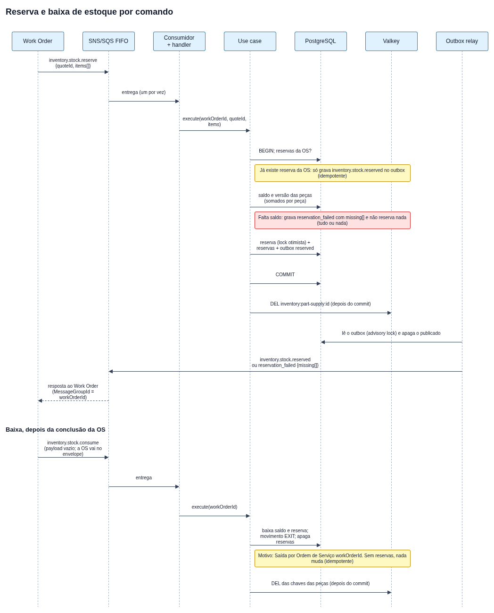

# Mensageria

O Inventory participa da Saga de orçamento e de ordem de serviço, orquestrada pelo Work Order, por mensagens no tópico SNS FIFO `oficina-events.fifo`. Ele consome da fila `inventory.fifo` e publica de volta no tópico, sempre pelo outbox. A topologia (tópico, filas, DLQs e filter policies) vem do repositório de infraestrutura de mensageria; a mecânica do relay e do consumidor está em [Arquitetura](architecture.md#mensageria-com-outbox).

Fonte editável em [`diagrams/src/stock-sequence.drawio`](diagrams/src/stock-sequence.drawio).

## Envelope

Toda mensagem tem `messageId`, `type`, `occurredAt`, `workOrderId` e `payload`. O contexto W3C (`traceparent`) vai nos atributos da mensagem. O `workOrderId` é anulável no envelope (mensagem sem ordem de serviço). O `MessageGroupId` é `workOrderId ?? messageId`: com ordem de serviço a ordem por OS se mantém; sem ela, cada mensagem forma um grupo próprio; o `MessageDeduplicationId` é o `messageId`.

## Comandos consumidos

| Tipo | `workOrderId` | Payload |
| --- | --- | --- |
| `inventory.stock.reserve` | obrigatório | `{ "quoteId": uuid, "items": [{ "partSupplyId": uuid, "quantity": inteiro > 0 }] }` (`items` não vazio) |
| `inventory.stock.consume` | obrigatório | `{}` (a ordem de serviço vem no envelope) |

Comando sem `workOrderId`, com payload inválido ou de tipo sem handler não é confirmado: a fila o reentrega e, na quinta vez, o SQS o move para `inventory-dlq.fifo`.

### Reserva

A reserva é **tudo ou nada** e **idempotente por ordem de serviço**, numa única transação. A idempotência vem das reservas existentes da ordem: um `inventory.stock.reserve` reentregue depois da baixa (reservas já apagadas) reservaria de novo.

1. Se já existe reserva para o `workOrderId`, não reserva de novo e grava `inventory.stock.reserved` com o `quoteId` do comando (a resposta é republicada).
2. Itens repetidos da mesma peça são somados. O saldo vem do PostgreSQL dentro da transação, nunca do cache. O disponível é `stock - reservedStock`; peça inexistente conta como disponível 0.
3. Se alguma peça não atende, nada é reservado e grava `inventory.stock.reservation_failed`.
4. Senão, aumenta `reserved_stock` de cada peça (com versão), grava uma reserva por peça e o `inventory.stock.reserved`, no mesmo commit.

### Baixa

`inventory.stock.consume` baixa, para cada reserva da ordem de serviço, o saldo e o reservado da peça, grava uma movimentação `EXIT` com o motivo `Saída por Ordem de Serviço <workOrderId>` e apaga as reservas, tudo numa transação. A idempotência vem da própria reserva: sem reservas, a baixa já foi feita (ou nunca houve reserva) e a repetição não muda nada. A baixa não publica evento.

## Eventos publicados

| Tipo | Payload | Quando |
| --- | --- | --- |
| `inventory.stock.reserved` | `{ "quoteId": uuid }` | Reserva concluída, ou comando repetido de uma ordem já reservada |
| `inventory.stock.reservation_failed` | `{ "quoteId": uuid, "missing": [{ "partSupplyId": uuid, "requested": inteiro, "available": inteiro }] }` | Alguma peça sem saldo disponível; `requested` é a soma pedida e `available` o disponível (0 se a peça não existe) |

Os dois levam o `workOrderId` da ordem no envelope. Não há evento de saldo atualizado: a movimentação manual é só um registro de log (`stock.updated`) e uma linha em `stock_movements`.

## Outbox e cache

O evento é gravado na tabela `outbox` na mesma transação que muda a reserva; o relay o publica e apaga a linha. Reservas e baixas invalidam, **depois do commit**, o cache das peças afetadas (`inventory:part-supply:<id>`); se a invalidação falha, a chave expira pelo TTL de 12 h.
